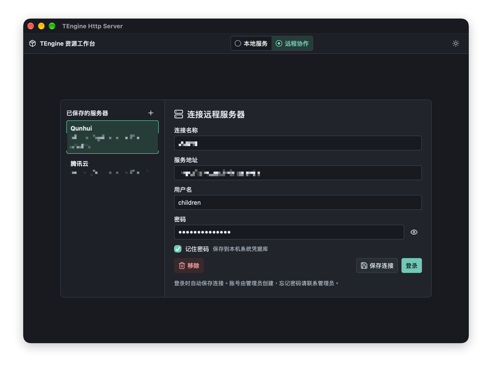
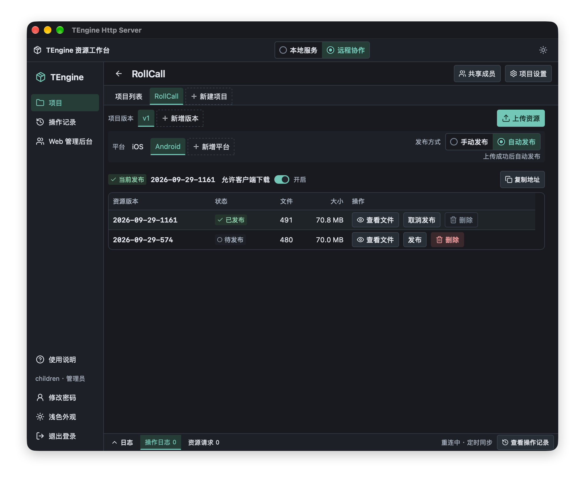
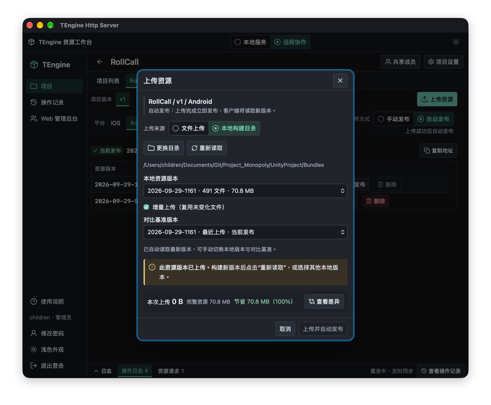
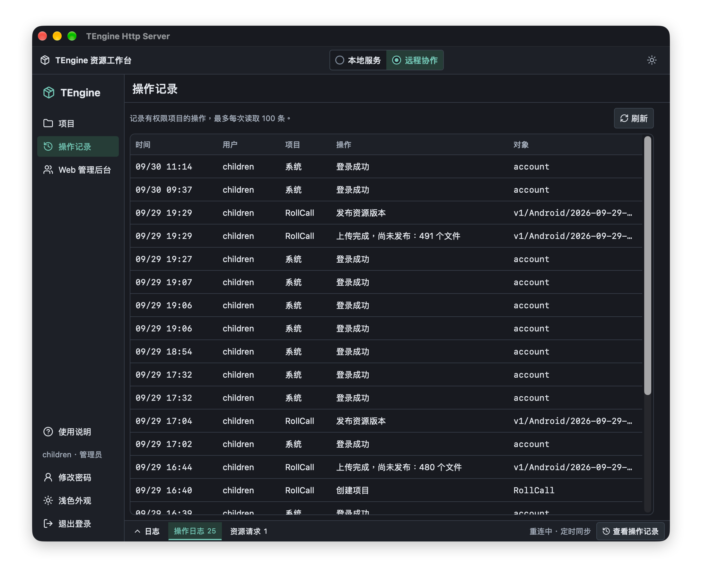
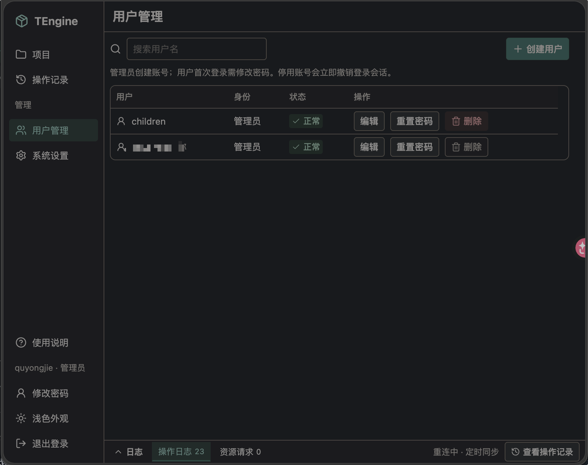

# TEngineHttp

**面向游戏资源、Android 应用和普通文件的版本管理与分发工具。**

TEngineHttp 把项目管理、文件上传、版本发布和下载分享放在一个工作台里。既可以在自己的电脑上做本地测试，也可以通过桌面客户端或浏览器管理服务器上的资源，适合个人开发者、小型团队和内部应用分发。

当前版本：**2.1.0**。

## 能做什么

| 项目类型 | 用途 |
| --- | --- |
| **Ⓐ APP更新** | 管理 Android 安装包与更新版本，附带可在浏览器中打开的说明页或交互教程 |
| **Ⓑ Bundle** | 管理 Unity [TEngine](https://github.com/ALEXTANGXIAO/TEngine) / [YooAsset](https://github.com/tuyoogame/YooAsset) 的游戏资源与热更新内容 |
| **Ⓕ 文件** | 发布文档、图片、压缩包及其他文件，统一管理版本和下载地址 |

项目标签通过 `Ⓐ / Ⓑ / Ⓕ` 区分类型，悬停可查看完整名称。

## 三种使用方式

| 方式 | 适用场景 |
| --- | --- |
| **桌面本地** | 在自己的电脑上整理和发布资源，供本机或局域网设备测试 |
| **桌面远程** | 连接服务器或 NAS，选择本地目录，完成上传和版本发布 |
| **Web 管理端** | 直接使用浏览器管理项目、发布资源和与团队协作 |

三种方式使用一致的工作台布局，支持深色和浅色主题。Bundle 资源可按 Android、iOS、Windows、macOS、Linux、WebGL 等目标平台分别管理。

## 主要功能

- **项目与版本管理**：一个工作台管理多个项目；项目版本下保留多次资源发布，按需要切换生效版本。
- **上传与发布分开**：默认上传后由用户确认发布，也可启用自动发布；Bundle 支持比较文件差异并仅上传变化内容。
- **Android 应用更新**：管理安装包、更新说明和历史发布，方便应用获取新版本。
- **独立教程附件**：可以只上传一个 HTML 页面，也可以选择包含网页、图片和样式的文件夹；无需重新上传安装包，确认上传后立即生效，地址保持固定。
- **目录记忆**：桌面端记住各项目选择的构建目录和教程目录，方便后续更新；浏览器端需重新选择本地文件或文件夹。
- **下载控制**：复制资源或教程地址，可按项目版本或平台开启、关闭客户端下载。
- **团队协作**：独立账号、项目共享和所有权转交；管理员管理用户，普通用户管理自己有权访问的项目。
- **操作追溯**：查看谁上传、发布或修改了项目；操作记录与资源访问记录分开显示。
- **多服务器连接**：桌面端保存常用连接，macOS / Windows 可选择使用系统凭据库保存密码。

教程附件适用于所有 APP 更新项目。单个 HTML 和多个关联页面都可以使用；文件夹目前只支持同一层文件，不包含子文件夹。网页在隔离环境中运行，依赖浏览器保存进度的教程应允许在无法保存时继续使用。

## 使用流程

1. 选择桌面本地、桌面远程或 Web 管理端。
2. 创建项目，选择项目类型和项目版本。
3. 选择文件或目录，确认上传内容。
4. 发布需要生效的资源版本，开启客户端下载。
5. 复制下载地址，供应用使用或分享给其他人。

APP 更新项目的“教程附件”单独管理，可以新增、替换、删除和直接打开网页，不需要等待安装包发布。

## 界面预览

保存服务器连接与登录：



项目工作台、版本发布与下载控制：



本地构建目录与增量上传：



项目操作记录：



Web 用户管理：



## 技术栈

| 部分 | 使用的技术 |
| --- | --- |
| 桌面应用 | Tauri 2、Rust |
| 桌面与 Web 界面 | Vue 3、TypeScript、Vite |
| 服务端 | Rust、Axum |
| 数据存储 | SQLite、本地文件存储 |
| 实时通信 | WebSocket |
| 服务端打包 | Docker |

桌面远程和 Web 管理端复用工作台组件，减少两端使用方式的差异。

## 目录结构

```text
src/                    桌面应用界面
src-tauri/              桌面原生功能与本地资源服务
shared/                 桌面和 Web 共用的组件、类型与资源规则
web-admin/              浏览器管理端
server/                 远程服务与安装工具
scripts/                项目维护脚本
docs/                   效果图及详细技术文档
.agents/、.ui-craft/     开发与界面设计约定
```

部署、开发、资源协议与项目维护说明集中在 [AGENTS.md](AGENTS.md)。

## 版本更新

### 2.1 — 应用更新、通用文件与教程附件

- 在 Bundle 资源之外，新增 APP 更新和普通文件两种项目类型。
- 使用 `Ⓐ / Ⓑ / Ⓕ` 项目标记，统一三种资源的管理入口。
- 支持 Android 构建目录识别、安装包更新和历史版本下载。
- 新增独立教程附件，支持单个 HTML 或整个平铺文件夹，上传后立即生效。
- 桌面本地、桌面远程和 Web 管理端均可管理教程，桌面端支持记住教程目录。

### 2.0 — 多用户资源工作台

- 增加独立账号、用户管理、项目共享与所有权转交。
- 统一桌面远程和 Web 工作台，支持深浅主题。
- 完善项目版本、资源发布、下载开关和增量上传。
- 增加多服务器连接、系统凭据保存，以及分开的操作记录和资源访问记录。

## License

MIT。项目内 UI Craft 的来源与许可证见 [.agents/skills/SOURCE.md](.agents/skills/SOURCE.md)。
